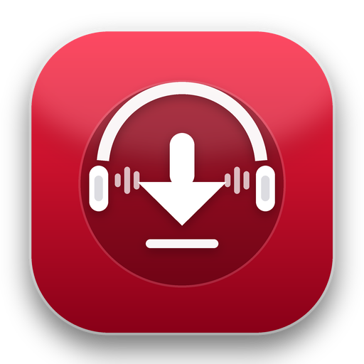

<div align="center">
  
  <h1>Descargador de YouTube</h1>
  <p><strong>Descarga música en alta calidad con carátula y videos en máxima resolución con yt-dlp y FFmpeg</strong></p>
</div>

---

## ⚡ Ejecución Rápida (Sin Comandos)

Tienes dos formas directas de abrir la aplicación con **doble clic**:

1. **`YouTube_Downloader.exe`**: Archivo ejecutable independiente con icono personalizado. Solo haz doble clic sobre él y se abrirá la aplicación directamente sin consola.
2. **`Iniciar_Descargador.bat`**: Acceso directo ligero por lotes que lanza la interfaz en segundo plano.

*(Puedes crearle un acceso directo en tu Escritorio haciendo clic derecho sobre `YouTube_Downloader.exe` -> "Enviar a" -> "Escritorio (crear acceso directo)").*

---

## 🎨 Características de la Interfaz Gráfica

- **Identidad Visual y Logotipo:** Nuevo diseño de logotipo moderno integrado en la barra de título, en la cabecera de la interfaz, en la barra de tareas de Windows y en el archivo ejecutable.
- **Ventana "Acerca de":** Información de la app y créditos de tecnologías accesibles desde el botón superior.
- **Campo de URL:** Permite pegar el enlace de YouTube directamente con el botón **Pegar**.
- **Selector de Tipo:** Alterna con un clic entre **🎬 Video** y **🎵 Música (Audio)**.
- **Selector de Calidad:**
  - **Audio:** 320 kbps (Máxima calidad), 256 kbps, 192 kbps, 128 kbps.
  - **Video:** Máxima resolución disponible, 1080p (Full HD), 720p (HD), 480p (SD).
- **Selector de Formato:**
  - **Audio:** MP3, M4A, WAV, FLAC.
  - **Video:** MP4, MKV.
- **Selector de Carpeta:** Puedes elegir dónde guardar las descargas y abrir la carpeta directamente con el botón **Abrir**.
- **Barra de Progreso y Estado en Vivo:** Visualiza el porcentaje, velocidad de descarga en MB/s y tiempo restante en tiempo real.
- **Metadatos y Carátula:** Incrusta automáticamente título, artista y portada original en los audios y videos compatibles.

---

## 🖼 Recursos y Logotipo (`assets/`)

El proyecto incluye un paquete completo de recursos gráficos optimizados:
- **`assets/icon.ico`**: Icono oficial de Windows con soporte multicapa (16, 24, 32, 48, 64, 128 y 256 px).
- **`assets/logo.png`**: Logotipo maestro en alta resolución (512x512).
- **`assets/logo.svg`**: Versión vectorial escalable.
- **`assets/logo_*.png`**: Variantes en múltiples tamaños para la interfaz y previsualizaciones.

Si deseas regenerar los iconos en cualquier momento:
```bash
python create_logo.py
```

---

## 🛠 Compilación del Ejecutable (`.exe`)

Para volver a compilar el ejecutable independiente incorporando el icono y los recursos:

```bash
pyinstaller --noconsole --onefile --noconfirm --icon="assets/icon.ico" --add-data="assets;assets" --collect-all customtkinter --name="YouTube_Downloader" app_gui.py
```

---

## 💻 Ejecución desde Terminal (Opcional)

Si alguna vez prefieres usar la consola:

- **Interfaz Gráfica:**
  ```bash
  python app_gui.py
  ```
- **Modo Terminal Interactivo:**
  ```bash
  python downloader.py
  ```
- **Descargas Directas:**
  ```bash
  python downloader.py "https://www.youtube.com/watch?v=..." --audio
  python downloader.py "https://www.youtube.com/watch?v=..." --video
  ```

---

## 📂 Organización de Archivos

Por defecto, los archivos descargados se guardan automáticamente en:
- 🎵 Música: `descargas/musica/`
- 🎬 Videos: `descargas/videos/`
